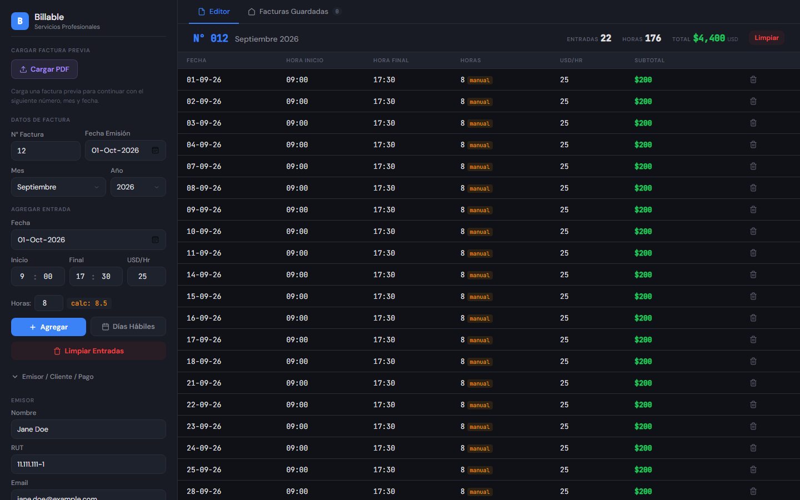

# Billable

A small self-hosted web app for freelancers who bill by the hour. Log the hours you worked, and it produces a monthly invoice PDF in US dollars ("Factura de Servicios Profesionales") and keeps a copy on your server.

The interface and the generated invoice are in Spanish.



## Features

- **Hour log to invoice.** Add entries one by one (date, start and end time, hourly rate) or fill every weekday of the month in one click. Subtotals are calculated for you, and the hours billed can be set separately from the clock times.
- **PDF generated in the browser, without a PDF library.** The front end writes the PDF file byte by byte (objects, fonts, cross-reference table), so the server never has to render anything.
- **Continues from your last invoice.** Load the previous invoice PDF and the app reads its text to set the next invoice number, the billing period and the next working day.
- **Server-side storage.** Save invoices to the server, then list, preview, download or delete them from the "Facturas Guardadas" tab.
- **Your details stay out of the code.** Issuer, client and bank details are read from a `.env` file and can be edited per session in the "Emisor / Cliente / Pago" panel.

This tool only produces a PDF document. It is not connected to any tax authority and does not issue electronic tax invoices.

## Tech stack

- Backend: Python 3.12, Flask, Gunicorn
- Frontend: a single HTML page with vanilla JavaScript and CSS (no build step)
- Deployment: Docker and Docker Compose

## Project structure

```
.
├── app.py               # Flask app: serves the UI and the REST API
├── templates/
│   └── index.html       # UI, PDF writer and PDF reader
├── requirements.txt
├── Dockerfile
├── docker-compose.yml
├── .env.example         # example configuration (copy to .env)
├── docs/
│   └── screenshot.png   # UI with example data
├── .gitignore
└── .dockerignore
```

## Installation

### Option 1: Docker Compose (recommended)

Requirements: Docker with the Compose plugin.

1. Clone the repository:

   ```bash
   git clone https://github.com/<your-user>/billable.git
   cd billable
   ```

2. Create your configuration from the example and fill in your own details:

   ```bash
   cp .env.example .env
   nano .env
   ```

3. Create the folder where invoices will be stored, owned by your user:

   ```bash
   mkdir -p facturas
   ```

   Set `PUID` and `PGID` in `.env` to the output of `id -u` and `id -g`, so the container can write to that folder. To store invoices somewhere else (for example a NAS share), set `FACTURAS_HOST_DIR` to that path.

4. Build and start the container:

   ```bash
   docker compose up -d --build
   ```

5. Open `http://localhost:5050` (or the port you set in `PORT`).

Useful commands:

```bash
docker compose logs -f          # follow the logs
docker compose down             # stop and remove the container
docker compose up -d --build    # rebuild after pulling changes
```

### Option 2: Run with Python

Requirements: Python 3.10 or later.

```bash
git clone https://github.com/<your-user>/billable.git
cd billable
python -m venv .venv
source .venv/bin/activate        # Windows: .venv\Scripts\activate
pip install -r requirements.txt
cp .env.example .env             # then edit .env with your details
```

Start it with the Flask development server:

```bash
python app.py
```

or with Gunicorn (Linux and macOS):

```bash
gunicorn --bind 0.0.0.0:5000 --workers 2 app:app
```

Then open `http://localhost:5000`. Invoices are saved in `./facturas` unless `FACTURAS_DIR` is set.

## Configuration

All settings are environment variables, normally set in `.env`. Every one is optional: empty values simply show empty fields in the UI.

| Variable | Used for |
|----------|----------|
| `PORT` | Host port of the web UI (Docker only, default `5050`) |
| `PUID`, `PGID` | User and group the container runs as (Docker only, default `1000`) |
| `FACTURAS_HOST_DIR` | Host folder mounted for invoice storage (Docker only, default `./facturas`) |
| `FACTURAS_DIR` | Folder where the app stores PDFs (set automatically in Docker; default `./facturas`) |
| `EMITTER_NAME`, `EMITTER_TAX_ID`, `EMITTER_EMAIL` | Issuer block of the invoice |
| `CLIENT_NAME`, `CLIENT_ADDRESS` | Client block of the invoice |
| `BANK_NAME`, `BANK_ACCOUNT_TYPE`, `BANK_ACCOUNT_NUMBER`, `BANK_ACCOUNT_HOLDER`, `BANK_ACCOUNT_HOLDER_TAX_ID` | "Forma de pago" (payment details) section |
| `DEFAULT_HOURLY_RATE` | Rate pre-filled in the USD/Hr field |

`.env` is listed in `.gitignore` and `.dockerignore`, so it is never committed or copied into the image. Only `.env.example`, with placeholder values, is part of the repository.

## Usage

1. **Optional:** click **Cargar PDF** and pick your previous invoice. The invoice number, month and next date are filled in from it.
2. Check the invoice number, issue date, month and year.
3. Add entries with **Agregar**, or use **Días Hábiles** to add every weekday of the selected month with the current hours and rate.
4. Open **Emisor / Cliente / Pago** to review or change the details for this invoice.
5. Click **Generar PDF**, then choose **Guardar y Descargar** (save on the server and download) or **Solo Descargar** (download only).

Saved invoices are named `Factura_<Month>_<Year>_<NNN>.pdf`.

## API

| Method | Path | Description |
|--------|------|-------------|
| GET | `/api/info` | Invoice defaults read from the environment |
| GET | `/api/facturas` | List saved PDFs (name, size, saved date) |
| POST | `/api/facturas` | Save a PDF (raw PDF body, file name in the `X-Filename` header) |
| GET | `/api/facturas/<filename>` | View a PDF (`?download=1` to download it) |
| DELETE | `/api/facturas/<filename>` | Delete a PDF |

File names are sanitized, and a file with an existing name is saved with a `_dup_<timestamp>` suffix instead of being overwritten.
